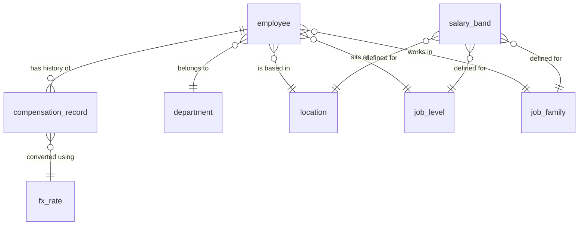

# Architecture

## Shape

Two deployables that talk over HTTP:

```
Next.js (Vercel)  ──▶  FastAPI (Render)  ──▶  SQLite
```

They are separate because they scale and deploy differently, and because a
plain JSON API is easier to test and to point a second client at later. The
cost is CORS configuration and no shared types across the boundary; a generated
TypeScript client from the OpenAPI schema closes most of that gap.

## Backend layers

```
api/        HTTP concerns — routing, request and response schemas, status codes
services/   domain logic — what a raise means, how compa-ratio is derived
repository/ data access — queries, joins, pagination
models/     SQLAlchemy tables
```

The split earns its keep in one place specifically: the "what was this person
paid on date X" logic belongs in a service that can be unit-tested against a
small in-memory dataset, not scattered through route handlers. Analytics is the
same story — the maths needs to be testable without an HTTP client in the way.

Routes stay thin. If a handler is doing arithmetic, it is in the wrong file.

## Data model



| Table | Holds |
| --- | --- |
| `employee` | identity, employment dates, and the role/location keys |
| `compensation_record` | one row per salary as of a date — the heart of the model |
| `salary_band` | min / mid / max per location, family and level |
| `location` | country, currency code |
| `department`, `job_family`, `job_level` | the dimensions analytics slices by |
| `fx_rate` | currency to base, effective-dated |

### Compensation is a sequence, not a column

The single most important decision here. An employee does not have a salary; an
employee has a series of effective-dated compensation records, and "current
salary" is the most recent record whose effective date has arrived.

This is what makes the rest possible. Raise history is free rather than a
separate audit table. Future-dated changes can be entered in advance without
appearing in today's reports. "What did we pay in Q2 last year" is a query
against data that still exists, instead of a question nobody can answer because
a cell was overwritten. Nothing is ever updated in place, so there is no way to
silently lose history.

The cost is that every read of a current salary is a per-employee lookup for the
latest qualifying row, which is the one genuinely tricky query in the system.
See [ADR 0001](adr/0001-effective-dated-compensation.md).

## Money

Amounts are integers in minor units — cents, pence, paise. Floats are not
allowed anywhere near a salary; binary floating point cannot represent 0.1, and
rounding drift across 10,000 rows turns into visible nonsense in an aggregate.

Each record carries its own currency. Cross-country comparison converts to a
base currency using the rate effective on that record's date, stored alongside
the record rather than looked up at read time. That way a report about 2023 says
the same thing next year. See [ADR 0002](adr/0002-money-as-integer-minor-units.md)
and [ADR 0003](adr/0003-snapshot-fx-rates.md).

## Performance

Ten thousand employees is small, but the query shapes still matter and the
wrong ones are easy to write:

- Pagination, filtering and sorting happen in SQL. The API never returns an
  unbounded list.
- Fetching current compensation for a page of employees is one windowed query,
  not one query per row. Tests assert the query count so an N+1 cannot creep
  back in unnoticed.
- Analytics aggregates in the database. Pulling 10,000 rows into Python to take
  a median would work at this size and fail at the next one.
- Indexes on the compensation lookup path and on the columns the directory
  filters by.

## Testing

Tests concentrate where mistakes are invisible rather than spreading evenly:

- **Temporal logic** — date boundaries, several records on one day, future-dated
  changes, employees with no record yet. Written before the implementation.
- **Analytics** — checked against figures worked out by hand, because a wrong
  median does not raise an exception. It just reports a plausible number.
- **Validation** — the rules that protect history from corruption.

Everything runs against SQLite in memory, so the suite stays fast and
deterministic with no fixture teardown to get wrong.

## Chosen to be simple

SQLite, because at this size it is sufficient and it makes the project trivial
to clone and run. SQLAlchemy keeps the Postgres migration to a connection
string. See [ADR 0004](adr/0004-sqlite-as-datastore.md).

Authentication is stubbed to a single HR-manager session. The access-control
seam exists in the API layer so a real implementation has somewhere to go, but
it is not built.
